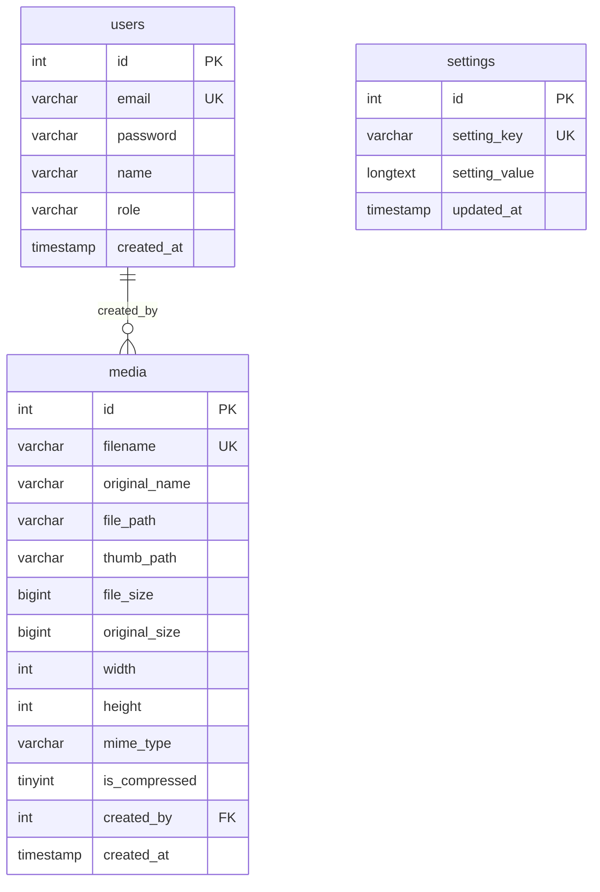

# Technical Architecture & Codebase Specification
**Application:** Image Optimizer (Web Media Processing Platform)  
**Version:** 1.0.7  
**Target Environment:** Hostinger Web Hosting (PHP 8.5, LiteSpeed/Apache, MySQL 5.7+/8.0+)  
**Design Paradigm:** Native Vanilla Architecture (Zero heavy dependencies: Native PHP + Vanilla JS ES6+ + Vanilla CSS3)  
**Document Purpose:** Optimized for AI agent parsing, semantic understanding, programmatic maintenance, and architectural navigation.

---

## Table of Contents
1. [System Architectural Overview](#1-system-architectural-overview)
2. [Complete Directory & File Location Map](#2-complete-directory--file-location-map)
3. [Database Schema & Data Persistence](#3-database-schema--data-persistence)
4. [Global Configuration & Environment (`config/`)](#4-global-configuration--environment-config)
5. [Core Backend Modules & Classes (`includes/`)](#5-core-backend-modules--classes-includes)
   - 5.1 [`ImageProcessor.php` (Image Processing Engine)](#51-imageprocessorphp-image-processing-engine)
   - 5.2 [`auth.php` (Authentication, Sessions & RBAC)](#52-authphp-authentication-sessions--rbac)
   - 5.3 [`settings.php` (System Configuration & SMTP Persistence)](#53-settingsphp-system-configuration--smtp-persistence)
   - 5.4 [`Mailer.php` (Native Socket SMTP Engine & HTML Templates)](#54-mailerphp-native-socket-smtp-engine--html-templates)
   - 5.5 [`logger.php` (Structured Telemetry)](#55-loggerphp-structured-telemetry)
   - 5.6 [`header.php` & `footer.php` (Templating, Profile Dropdown & Layouts)](#56-headerphp--footerphp-templating-profile-dropdown--layouts)
6. [API Layer & REST Endpoints (`api/`)](#6-api-layer--rest-endpoints-api)
   - 6.1 [`POST api/process_image.php`](#61-post-apiprocess_imagephp)
   - 6.2 [`POST api/delete_media.php`](#62-post-apidelete_mediaphp)
   - 6.3 [`POST api/create_user.php`](#63-post-apicreate_userphp)
   - 6.4 [`POST api/edit_user.php`](#64-post-apiedit_userphp)
   - 6.5 [`POST api/update_profile.php`](#65-post-apiupdate_profilephp)
   - 6.6 [`POST api/save_smtp.php`](#66-post-apisave_smtpphp)
   - 6.7 [`POST api/test_smtp.php`](#67-post-apitest_smtpphp)
   - 6.8 [`POST api/clear_logs.php`](#68-post-apiclear_logsphp)
   - 6.9 [`GET api/download_log.php`](#69-get-apidownload_logphp)
   - 6.10 [`GET api/export_csv.php`](#610-get-apiexport_csvphp)
   - 6.11 [`GET api/download_zip.php`](#611-get-apidownload_zipphp)
7. [Frontend Controllers & Views (Root Directory)](#7-frontend-controllers--views-root-directory)
   - 7.1 [`index.php` (Upload & Optimization Center)](#71-indexphp-upload--optimization-center)
   - 7.2 [`media.php` (Media Library & Metadata Explorer)](#72-mediaphp-media-library--metadata-explorer)
   - 7.3 [`profile.php` (Personal Profile & Password Management)](#73-profilephp-personal-profile--password-management)
   - 7.4 [`smtp.php` (SMTP Server Configuration & Live Diagnostics)](#74-smtpphp-smtp-server-configuration--live-diagnostics)
   - 7.5 [`users.php` (Access Control & User Management)](#75-usersphp-access-control--user-management)
   - 7.6 [`logs.php` (Diagnostics & Audit Console)](#76-logsphp-diagnostics--audit-console)
   - 7.7 [`login.php` & `logout.php` (Session Gateways)](#77-loginphp--logoutphp-session-gateways)
   - 7.8 [`test_debug.php` (System Diagnostics Probe)](#78-test_debugphp-system-diagnostics-probe)
8. [Client-Side Architecture (`assets/js/` & `assets/css/`)](#8-client-side-architecture-assetsjs--assetscss)
   - 8.1 [`uploader.js` (Sequential AJAX Batch Processing)](#81-uploaderjs-sequential-ajax-batch-processing)
   - 8.2 [`media.js` (DOM Filter, Clipboard & Deletion Dispatch)](#82-mediajs-dom-filter-clipboard--deletion-dispatch)
   - 8.3 [`app.js` (Global UI Utilities, Toast, Lightbox & Profile Dropdown)](#83-appjs-global-ui-utilities-toast-lightbox--profile-dropdown)
   - 8.4 [`style.css` (Design System & Design Tokens)](#84-stylecss-design-system--design-tokens)
9. [Security, Hardening & Server Protection](#9-security-hardening--server-protection)
10. [AI Developer Workflow & Operational Runbook](#10-ai-developer-workflow--operational-runbook)

---

## 1. System Architectural Overview

The **Image Optimizer** application is a lightweight, high-performance web asset processing and management platform built specifically for shared/cloud hosting environments (Hostinger PHP 8.5).

### Key Architectural Characteristics
- **Processing Strategy:** High-volume image uploads are processed **sequentially via client-side AJAX dispatch**. Instead of submitting large multi-part requests that crash server memory or trip `max_execution_time`, each file is piped as an individual HTTP POST request (`api/process_image.php`).
- **Dual Storage Modes (Persistent Library vs. Ephemeral ZIP Download):** Users can either persist optimized images to the server (`uploads/` + MySQL `media` table) or select **Download as ZIP (`zip_only`)**, which processes the batch into an isolated temporary directory (`uploads/temp_zip/{batch_id}`), packages them into a `.zip` archive via `api/download_zip.php`, streams the download, and immediately deletes both the batch files and the `.zip` archive from the server.
- **Dual-Engine Processing:** Utilizes `Imagick` (ImageMagick) as the primary image transformation driver with dynamic fallback to PHP `GD` if `Imagick` is unavailable or fails.
- **Strict SEO & Clean Filename Standardization:** Transforms arbitrary uploaded file basenames into lowercase, accent-free, URL-friendly slugs (e.g., `Foto de Cumpleaños! (1).PNG` -> `foto-de-cumpleanos-1.jpg`).
- **Guaranteed Size Optimization (< 1 MB target):** Intelligent compression pipelines (subsampling 4:2:0, progressive JPEG rendering, metadata stripping, Lanczos/Triangle resampling) produce web-ready assets significantly below 1 MB.
- **Native SMTP Transport & Email Templating:** Implements RFC 5321 communication directly over PHP sockets (`stream_socket_client`) with SSL (`465`) and STARTTLS (`587`), zero Composer dependencies, live interactive step-by-step diagnostic logging, and modular responsive HTML templates for account onboarding, password resets, and connectivity verification.
- **Zero-Dependency Core:** Eliminates Composer packages, Node build steps, and framework overhead, ensuring 100% portability via standard FTP/SFTP deployment.

```mermaid
graph TD
    Client[Web Browser Client] -->|AJAX Fetch Sequential Queue| API[api/process_image.php]
    Client -->|Auto-Download Trigger| ZipAPI[api/download_zip.php]
    Client -->|Profile & Password Updates| ProfileAPI[api/update_profile.php]
    Client -->|User Management Updates| EditUserAPI[api/edit_user.php]
    Client -->|SMTP Configuration & Test| SmtpAPI[api/save_smtp.php & api/test_smtp.php]
    Client -->|Standard HTTP GET| Views[Root Views: index, media, profile, smtp, users, logs]
    
    API --> Auth[includes/auth.php Session + CSRF Verification]
    API --> Processor[includes/ImageProcessor.php]
    SmtpAPI --> MailerEngine[includes/Mailer.php Native SMTP Sockets]
    
    Processor --> EngineCheck{Imagick Loaded?}
    EngineCheck -->|Yes| ImagickEngine[processWithImagick()]
    EngineCheck -->|No / Catch| GDEngine[processWithGD()]
    
    Processor -->|Standard Mode| DiskUploads[(File System: uploads/ & uploads/thumbs/)]
    Processor -->|ZIP Mode| TempBatch[(Temp Dir: uploads/temp_zip/batch_id/)]
    ZipAPI -->|Pack, Stream & Unlink| TempBatch
    API -->|Standard Mode| DB[(MySQL Database: media, users, settings tables)]
    API --> Logger[includes/logger.php -> logs/debug.log]
```

---

## 2. Complete Directory & File Location Map

### Root Directory: `g:\Mi unidad\website-ftp\imortsdevcristian\`

```
.
├── .docs/
│   └── docs_main.md              # Technical codebase documentation for AI agents
├── .vscode/
│   ├── db.md                     # Database connection testing reference
│   └── sftp.json                 # Remote FTP deployment server settings
├── api/
│   ├── clear_logs.php            # Endpoint to truncate logs/debug.log
│   ├── create_user.php           # Endpoint to create admin or customer users + dispatch SMTP welcome
│   ├── delete_media.php          # Endpoint to delete media DB record & unlink files (single & bulk)
│   ├── download_log.php          # Raw stream download for debug.log
│   ├── download_zip.php          # Temporary batch ZIP packager, streamer & auto-cleaner
│   ├── edit_user.php             # Endpoint to update existing users (name, email, role, password)
│   ├── export_csv.php            # Excel-compatible UTF-8 BOM CSV exporter
│   ├── process_image.php         # Sequential single-image processor endpoint
│   ├── save_smtp.php             # Endpoint to persist SMTP server configuration
│   ├── test_smtp.php             # Real-time socket SMTP test runner with live transcript
│   └── update_profile.php        # Authenticated self-service profile and password updater
├── assets/
│   ├── css/
│   │   └── style.css             # Main stylesheet (Design tokens, components, profile dropdown, SMTP)
│   └── js/
│       ├── app.js                # Core global utilities (Toasts, clipboard, lightbox, profile dropdown)
│       ├── media.js              # Media library DOM operations, search filters & bulk actions
│       └── uploader.js           # Drag-and-drop & sequential AJAX queue coordinator
├── config/
│   ├── config.php                # System constants, dimensions, MIME types, base_url()
│   └── database.php              # PDO MySQL Singleton & auto-migration engine
├── includes/
│   ├── auth.php                  # Authentication, sessions, RBAC & CSRF safeguards
│   ├── footer.php                # Common markup footer, modals, dynamic script loader
│   ├── header.php                # Common markup header, navbar, profile dropdown & admin menu
│   ├── ImageProcessor.php        # Core transformation service (Imagick + GD + Slugify)
│   ├── logger.php                # Append-only file logger with JSON context
│   ├── Mailer.php                # Native socket-based RFC 5321 SMTP client & HTML templates
│   └── settings.php              # Key-value system settings service & SMTP helpers
├── logs/
│   └── debug.log                 # Server-side audit log
├── uploads/
│   ├── .htaccess                 # Security shield: forbids PHP execution, allows images
│   ├── temp_zip/                 # Ephemeral batch directories for ZIP-only mode (auto-deleted)
│   └── thumbs/                   # Generated 260px proportional thumbnails
├── .htaccess                     # Root Apache/LiteSpeed security rules
├── GEMINI.md                     # Project governing rules (Logging, FTP workflow, PHP 8.5)
├── index.php                     # View: Image uploader dashboard
├── login.php                     # View: Secure authentication form
├── logout.php                    # Controller: Session termination & redirect
├── logs.php                      # View: System telemetry, stats & live terminal viewer
├── media.php                     # View: Image gallery, URL copier & deletion manager
├── profile.php                   # View: User profile details & password change
├── schema.sql                    # Initial SQL DDL schema & seed admin
├── smtp.php                      # View: Admin SMTP configuration & live test terminal
├── test_debug.php                # Diagnostic probe script (extensions, DB, write tests)
└── users.php                     # View: User management & RBAC administration
```

---

## 3. Database Schema & Data Persistence

The application relies on MySQL (InnoDB engine, `utf8mb4_unicode_ci` collation). The connection is managed via PDO.

### 3.1 Entity Relationship Model



### 3.2 Table Definitions

#### Table: `users`
Stores authenticated principals with role-based access.

| Column | Type | Nullable | Key | Default | Description |
|---|---|---|---|---|---|
| `id` | `INT` | NO | `PRIMARY KEY AUTO_INCREMENT` | NULL | Unique user identifier. |
| `email` | `VARCHAR(191)` | NO | `UNIQUE` | NULL | User login email (191 chars for UTF8MB4 index limit). |
| `password` | `VARCHAR(255)` | NO | | NULL | Passwords hashed using `PASSWORD_DEFAULT` (Bcrypt). |
| `name` | `VARCHAR(100)` | NO | | `'Administrador'` | Display name for UI badges and audit logs. |
| `role` | `VARCHAR(30)` | NO | | `'admin'` | Role name: `'admin'` (full access) or `'customer'` (upload & media only). |
| `created_at` | `TIMESTAMP` | YES | | `CURRENT_TIMESTAMP` | Account creation timestamp. |

*Initial Seed Admin:*
- Email: `hola@devcristian.com`
- Default Password: `admin` (Hash: `$2y$12$nOS7u7mPV/bPiCNLnRdFYuFeDAk3frwLtX5vjGUEjGUYxUTFc092.`)

#### Table: `media`
Main metadata catalog for every processed and optimized asset.

| Column | Type | Nullable | Key | Default | Description |
|---|---|---|---|---|---|
| `id` | `INT` | NO | `PRIMARY KEY AUTO_INCREMENT` | NULL | Auto-increment primary key. |
| `filename` | `VARCHAR(255)` | NO | `INDEX idx_media_filename` | NULL | Normalized, collision-free slug filename on disk. |
| `original_name` | `VARCHAR(255)` | NO | | NULL | Original filename as sent by the client. |
| `file_path` | `VARCHAR(255)` | NO | | NULL | Relative path to main optimized image (`uploads/filename.ext`). |
| `thumb_path` | `VARCHAR(255)` | NO | | NULL | Relative path to thumbnail (`uploads/thumbs/filename.ext`). |
| `file_size` | `BIGINT` | NO | | NULL | Final optimized file size in bytes. |
| `original_size` | `BIGINT` | NO | | NULL | Original upload size in bytes. |
| `width` | `INT` | NO | | NULL | Final image width in pixels. |
| `height` | `INT` | NO | | NULL | Final image height in pixels. |
| `mime_type` | `VARCHAR(50)` | NO | | NULL | Detected MIME type (e.g. `image/jpeg`). |
| `is_compressed` | `TINYINT(1)` | NO | | `0` | Boolean flag (1 = compressed, 0 = standard). |
| `created_by` | `INT` | YES | | `NULL` | Foreign key referencing `users.id`. |
| `created_at` | `TIMESTAMP` | YES | `INDEX idx_media_created_at` | `CURRENT_TIMESTAMP` | Timestamp of upload completion. |

#### Table: `settings`
Persistent key-value system settings store, used for global configurations including SMTP credentials without overwriting on FTP syncs.

| Column | Type | Nullable | Key | Default | Description |
|---|---|---|---|---|---|
| `id` | `INT` | NO | `PRIMARY KEY AUTO_INCREMENT` | NULL | Unique setting row identifier. |
| `setting_key` | `VARCHAR(100)` | NO | `UNIQUE INDEX idx_settings_key` | NULL | Unique parameter key identifier (e.g. `smtp_config`). |
| `setting_value` | `LONGTEXT` | YES | | NULL | Serialized JSON string or raw text payload. |
| `updated_at` | `TIMESTAMP` | YES | | `CURRENT_TIMESTAMP ON UPDATE CURRENT_TIMESTAMP` | Last modification timestamp. |

---

## 4. Global Configuration & Environment (`config/`)

### 4.1 `config/config.php`
- **Timezone:** Forced to `America/Bogota` via `date_default_timezone_set()`.
- **System Constants:**
  - `APP_NAME`: `'Image Optimizer'`
  - `APP_VERSION`: `'1.0.2'`
  - `ROOT_PATH`: Base filesystem path resolved with `dirname(__DIR__)`.
  - `UPLOAD_DIR`: Absolute path to `uploads/`.
  - `THUMB_DIR`: Absolute path to `uploads/thumbs/`.
  - `TEMP_ZIP_DIR`: Absolute path to `uploads/temp_zip/` (ephemeral workspace for ZIP batch downloads).
  - `LOGS_DIR`: Absolute path to `logs/`.
  - `DEFAULT_MAX_WIDTH`: `1920` (Default desktop boundary).
  - `MAX_ALLOWED_WIDTH`: `2048` (Ceiling limit).
  - `MIN_ALLOWED_WIDTH`: `50` (Floor limit).
  - `DEFAULT_COMPRESS_QUALITY`: `76` (Guarantees output < 1 MB while retaining visual acuity).
  - `ALLOWED_EXTENSIONS`: `['jpg', 'jpeg', 'png', 'webp', 'avif']`
  - `ALLOWED_MIMES`: `['image/jpeg', 'image/pjpeg', 'image/png', 'image/x-png', 'image/webp', 'image/avif']`
  - `MAX_UPLOAD_SIZE_BYTES`: `26214400` (25 Megabytes).

#### Function: `base_url(string $path = ''): string`
Dynamically detects the exact base protocol (`http://` or `https://` via `HTTPS`, port `443`, or `HTTP_X_FORWARDED_PROTO`), host name (`HTTP_HOST`), and relative directory path (stripping `/api` if invoked from backend endpoints). Safely appends an optional relative path.

---

### 4.2 `config/database.php`
Contains the database abstraction and connection lifecycle.

- **Credentials Definition:** Reads environment variables (`getenv()`) with Hostinger production fallbacks:
  - `DB_HOST`: `'localhost'`
  - `DB_PORT`: `'3306'`
  - `DB_NAME`: `'u757198907_importsdvcris'`
  - `DB_USER`: `'u757198907_importsdvcris'`
  - `DB_PASS`: `'7f85M4+K;'`

#### Function: `get_db(): PDO`
- **Pattern:** Static Singleton.
- **Attributes Configured:**
  - `PDO::ATTR_ERRMODE => PDO::ERRMODE_EXCEPTION`
  - `PDO::ATTR_DEFAULT_FETCH_MODE => PDO::FETCH_ASSOC`
  - `PDO::ATTR_EMULATE_PREPARES => false`
- **Encoding:** Explicitly enforces `SET NAMES utf8mb4 COLLATE utf8mb4_unicode_ci`.
- **Error Handling:** On connection failure, logs detailed context to `logs/debug.log` and throws a `RuntimeException`. Automatically invokes `init_database_schema($pdo)`.

#### Function: `init_database_schema(PDO $pdo): void`
- **Purpose:** Idempotent schema initialization and auto-migration.
- **Workflow:**
  1. Executes `CREATE TABLE IF NOT EXISTS users ...`.
  2. Inspects columns of `users` table via `SHOW COLUMNS`; automatically issues `ALTER TABLE` to add `name` and `role` if missing.
  3. Executes `CREATE TABLE IF NOT EXISTS media ...`.
  4. Checks for initial admin account (`hola@devcristian.com`); inserts it if missing.

---

## 5. Core Backend Modules & Classes (`includes/`)

### 5.1 `ImageProcessor.php` (Image Processing Engine)
Static class encapsulating all normalization, validation, renaming, and transformation logic.

#### Methods:

##### `public static function slugify(string $text): string`
- **Purpose:** Normalizes filenames for SEO and web compliance.
- **Logic:**
  1. Performs fast associative dictionary lookup (`strtr`) for Spanish and Latin diacritics (`á, é, í, ó, ú, ñ, ü`, uppercase and lowercase).
  2. Uses PHP `\Transliterator::create('Any-Latin; Latin-ASCII')` if the `intl` extension is active; falls back to `iconv`.
  3. Converts to lowercase UTF-8 via `mb_strtolower`.
  4. Strips all characters except `[a-z0-9]` using regex `/[^a-z0-9]+/i`, replacing them with single hyphens `-`.
  5. Trims leading and trailing hyphens. Returns `'imagen'` if empty.

##### `private static function nameExistsInDb(string $filename): bool`
- **Purpose:** Checks collision against the `media.filename` column using prepared PDO query.

##### `public static function generateUniqueFilename(string $slug, string $ext, ?string $customDir = null): string`
- **Purpose:** Produces collision-free filenames without random hashes.
- **Naming Rule:**
  - First occurrence: `{slug}.{ext}` (e.g. `zapato-deportivo.jpg`)
  - Duplicate occurrences: Increments with hyphen-number `{slug}-{counter}.{ext}` (e.g. `zapato-deportivo-1.jpg`, `zapato-deportivo-2.jpg`).
  - If `$customDir` is provided (temporary ZIP mode), checks collisions strictly inside that isolated batch directory without querying `uploads/` or the `media` database table.
  - Otherwise, verifies both local file existence in `uploads/` and row existence in `media` table.

##### `public static function process(array $fileInput, int $maxWidth = DEFAULT_MAX_WIDTH, bool $compress = true, bool $convertToJpg = false, ?string $customOutputDir = null, bool $generateThumb = true): array`
- **Parameters:**
  - `array $fileInput`: Item from `$_FILES['image']`.
  - `int $maxWidth`: Constraint boundary (clamped between 50 and 2048 px).
  - `bool $compress`: Whether aggressive compression is active (quality 76, 4:2:0 subsampling, metadata stripping).
  - `bool $convertToJpg`: If `true` and the source format is not JPG (e.g. PNG), converts the image to JPG over a solid white background.
  - `?string $customOutputDir`: Optional custom directory path for temporary batch processing (`uploads/temp_zip/{batch_id}`).
  - `bool $generateThumb`: Whether to generate a 260px thumbnail (`false` in temporary ZIP mode).
- **Processing Pipeline:**
  1. Validates `is_uploaded_file()`, `UPLOAD_ERR_OK`, and `MAX_UPLOAD_SIZE_BYTES` (25MB).
  2. Inspects real file MIME type using `finfo(FILEINFO_MIME_TYPE)` against `ALLOWED_MIMES`.
  3. Determines target extension. If `$convertToJpg` is requested on a PNG, sets target extension to `'jpg'`.
  4. Generates clean slug and collision-free filename.
  5. Asserts existence of target output directory (and `uploads/thumbs/` if `$generateThumb` is true).
  6. Attempts processing using `processWithImagick()`. If `Imagick` is absent or throws an exception, catches and seamlessly falls back to `processWithGD()`.
  7. Flushes file stat cache with `clearstatcache()`, calculates saved bytes and percentage.
  8. Returns structured associative metadata array.

##### `private static function processWithImagick(string $src, string $dest, ?string $thumbDest, int $maxWidth, bool $compress, string $targetExt, bool $convertedToJpg): array`
- **Imagick Pipeline:**
  1. Calls `$im->autoOrient()` to honor smartphone camera EXIF orientation tags.
  2. Calculates aspect ratio: **NEVER upscales** (if `origWidth <= maxWidth`, keeps original dimensions).
  3. Applies `$im->resizeImage()` with `Imagick::FILTER_LANCZOS`.
  4. **Transparency & JPG Conversion:** When target is JPG, flattens image over a solid white background (`setImageBackgroundColor('white')`, `mergeImageLayers(LAYERMETHOD_FLATTEN)`) to prevent black transparent areas.
  5. **Web Optimization:** Configures `setSamplingFactors(['2x2', '1x1', '1x1'])` (essential 4:2:0 chroma subsampling), sets interlacing `INTERLACE_JPEG` for progressive rendering, strips all EXIF/ICC profiles via `stripImage()`, and sets quality to `76`.
  6. Writes destination file to `$dest`.
  7. If `$thumbDest` is not null, clones image, resizes to max `260px` width using `FILTER_TRIANGLE` (never upscales if smaller), compresses at quality `75`, and writes thumbnail to `$thumbDest`.
  8. Destroys resources and returns `['width', 'height']`.

##### `private static function processWithGD(string $src, string $dest, ?string $thumbDest, int $maxWidth, bool $compress, string $targetExt, bool $convertedToJpg): array`
- **GD Pipeline:**
  1. Reads dimensions using `@getimagesize($src)`.
  2. Instantiates source image resource via `imagecreatefromjpeg`, `imagecreatefrompng`, `imagecreatefromwebp`, or `imagecreatefromavif` (with fallback to `imagecreatefromstring`).
  3. Prepares truecolor canvas `imagecreatetruecolor()` for proportional dimensions (no upscaling).
  4. Preserves alpha channel for PNG/WebP using `imagealphablending($dst, false)` and `imagesavealpha($dst, true)`, or paints white background for JPG targets using `imagecolorallocate($dst, 255, 255, 255)`.
  5. Resamples via `imagecopyresampled()`.
  6. Calls `saveGDImage()` helper with target quality.
  7. If `$thumbDest` is not null, clones thumbnail canvas (max 260px), resamples, and writes thumbnail.
  8. Destroys GD image objects via `imagedestroy()`.

##### `private static function saveGDImage(\GdImage $img, string $dest, string $ext, int $quality): void`
Routes GD destination output to `imagejpeg`, `imagepng` (compression level 9), `imagewebp`, or `imageavif`.

---

### 5.2 `auth.php` (Authentication, Sessions & RBAC)
Handles security contexts, cookie protection, role verification, and anti-CSRF tokens.

- **Session Initialization:** Configures secure session parameters before invoking `session_start()`:
  - `session.cookie_httponly = 1`
  - `session.use_only_cookies = 1`
  - `session.cookie_secure = 1` (automatically active if HTTPS is present)
  - `session_name('imgopt_session')`

#### Core Functions:
- `is_logged_in(): bool`: Returns true if `$_SESSION['user']['id']` is populated.
- `current_user(): ?array`: Returns user session payload: `['id', 'email', 'name', 'role']`.
- `require_login(): void`: Enforces authentication; redirects unauthenticated requests to `login.php`.
- `is_admin(): bool`: Returns true if logged in and role equals `'admin'`.
- `require_admin(): void`: Enforces admin privileges; redirects non-admin users to `index.php`.
- `csrf_token(): string`: Lazily generates and stores a 32-byte cryptographically secure token (`bin2hex(random_bytes(32))`) in `$_SESSION['csrf_token']`.
- `verify_csrf(?string $token): bool`: Validates token using timing-safe comparison `hash_equals()`.
- `attempt_login(string $email, string $password): array`:
  1. Sanitizes email input.
  2. Queries user record by email via prepared statement.
  3. Verifies password hash using native `password_verify()`.
  4. Calls `session_regenerate_id(true)` upon successful verification to mitigate session fixation attacks.
  5. Writes user data to `$_SESSION['user']` and logs the event to `logs/debug.log`.
  6. Returns `['success' => bool, 'message' => string]`.
- `logout_user(): void`: Logs logout event, wipes `$_SESSION`, expires session cookie in client browser, and destroys the session.

---

### 5.3 `settings.php` (System Configuration & SMTP Persistence)
Key-value settings repository persisting global configurations to MySQL `settings` table.

#### Core Functions:
- `get_setting(string $key, mixed $default = null): mixed`: Retrieves a setting by key and automatically deserializes JSON or returns raw string/default.
- `set_setting(string $key, mixed $value): bool`: Persists setting via `INSERT ... ON DUPLICATE KEY UPDATE` prepared statement with automated JSON serialization for arrays/objects.
- `get_smtp_config(): array`: Returns structured SMTP credentials dictionary with defaults (`host`, `port`, `encryption`, `auth`, `username`, `password`, `from_email`, `from_name`).
- `save_smtp_config(array $newConfig): bool`: Merges and securely updates SMTP configuration while preserving existing password if omitted.

---

### 5.4 `Mailer.php` (Native Socket SMTP Engine & HTML Templates)
Pure PHP RFC 5321 native SMTP client built on network sockets (`stream_socket_client`). Zero third-party dependencies.

#### Protocol Capabilities:
- Direct SSL socket connections on port 465 (`ssl://host:port`) and STARTTLS cryptographic negotiation on port 587 (`stream_socket_enable_crypto`).
- Native `AUTH LOGIN` authentication support with Base64 encoding.
- Step-by-step real-time protocol transcription (`SYS`, `CLIENT`, `SERVER`, `ERR`) for in-browser visual debugging.
- Fully compatible with Hostinger, cPanel, Google Workspace, and transactional SMTP relays.

#### Core Methods:
- `Mailer::send(string $to, string $subject, string $htmlBody, ?array $customConfig = null): array`: Low-level socket engine executing RFC 5321 handshake (`EHLO`, `STARTTLS`, `AUTH LOGIN`, `MAIL FROM`, `RCPT TO`, `DATA`, `QUIT`).
- `Mailer::getTemplate(string $title, string $contentHtml, ?string $ctaText = null, ?string $ctaUrl = null, ?string $footerNote = null): string`: Responsive, ultra-clean HTML email scaffolding with card layout, typography, and branded action buttons.
- `Mailer::sendTestEmail(string $recipient, ?array $customConfig = null): array`: Dispatches an automated test email confirming SMTP health.
- `Mailer::sendAccountCreatedEmail(string $name, string $email, string $password, ?string $loginUrl = null): array`: Dispatches formatted welcome message containing initial login credentials.
- `Mailer::sendPasswordResetEmail(string $name, string $email, string $resetUrl): array`: Dispatches single-use password recovery message.

---

### 5.5 `logger.php` (Structured Telemetry)
Append-only logging utility for tracing server actions and diagnosing operational issues.

#### Function: `app_log(string $message, array $context = []): void`
- **Output Destination:** `logs/debug.log`.
- **Log Format:** `[YYYY-MM-DD HH:MM:SS] [REMOTE_IP] Message | Context: {"json":"payload"}\n`
- **File Locking:** Uses `FILE_APPEND | LOCK_EX` to ensure thread-safe concurrent writes.
- **Auto-Provisioning:** Creates `logs/` directory with `0755` permissions if not yet present.

---

### 5.6 `header.php` & `footer.php` (Templating, Profile Dropdown & Layouts)

#### `header.php`
- Extracts `$currentPage` via `basename($_SERVER['PHP_SELF'])`.
- Injects `<meta name="csrf-token" content="...">`.
- Imports `Remix Icon v4.2.0` stylesheet via CDN.
- Imports `assets/css/style.css` versioned with `APP_VERSION`.
- Renders streamlined main navigation links:
  - **Subir y Optimizar** (`index.php`)
  - **Medios** (`media.php`)
- Renders **Interactive Profile Dropdown (`#user-dropdown-container`)**:
  - Profile trigger with rounded user initial avatar circle, display name, and chevron arrow.
  - Dropdown card containing user display name, email, and role badge (`role-admin` or `role-user`).
  - Self-service action: **Mi Perfil y Contraseña** (`profile.php`).
  - **Admin-Only "Configuración" Section** (rendered only when `is_admin() === true`):
    - **Usuarios** (`users.php`)
    - **Logs** (`logs.php`)
    - **SMTP** (`smtp.php`)
  - Danger action: **Cerrar Sesión** (`logout.php`).

#### `footer.php`
- Renders global Lightbox Modal markup (`#lightbox-modal`).
- Renders Toast notification anchor container (`#toast-container`).
- Imports `assets/js/app.js` versioned with `APP_VERSION`.
- Dynamically loads any page-specific scripts injected via `$extraScripts` array (e.g. `uploader.js`, `media.js`).

---

## 6. API Layer & REST Endpoints (`api/`)

All API routes return JSON responses (or binary streams for download endpoints) with standard HTTP status codes (`200`, `400`, `401`, `403`, `404`, `405`, `500`).

### 6.1 `POST api/process_image.php`
- **Access Level:** Authenticated users (`is_logged_in()`).
- **Purpose:** Core worker for the sequential batch processing queue. Supports both persistent library storage and ephemeral ZIP batch mode.
- **Headers:** `Content-Type: application/json`
- **Input Parameters (`multipart/form-data`):**
  - `image`: Binary file payload (`$_FILES['image']`).
  - `max_width`: Integer pixel width (default 1920).
  - `compress`: Boolean (1 or 0).
  - `convert_jpg`: Boolean (1 = convert PNG to JPG; 0 = preserve PNG).
  - `zip_only`: Boolean (1 = store temporarily in `uploads/temp_zip/{batch_id}` without DB record or thumbnail; 0 = standard persistent save).
  - `batch_id`: Alphanumeric batch identifier when `zip_only=1`.
  - `csrf_token`: Security token (or header `X-CSRF-Token`).
- **Processing Flow:**
  1. Checks authentication and CSRF.
  2. If `zip_only` is enabled, creates `TEMP_ZIP_DIR . '/' . $batchId`, runs `ImageProcessor::process(..., $batchDir, false)`, logs the temporary operation, and returns JSON immediately without touching the database.
  3. Otherwise, executes `ImageProcessor::process()` into `uploads/` and `uploads/thumbs/`, inserts the metadata record into `media` table, and records the entry in `logs/debug.log`.
- **Response Format (`200 OK`):**
```json
{
  "success": true,
  "message": "Imagen procesada y guardada con éxito.",
  "data": {
    "id": 42,
    "filename": "banner-promocional.jpg",
    "original_name": "Banner Promocional 2026.png",
    "file_path": "uploads/banner-promocional.jpg",
    "thumb_path": "uploads/thumbs/banner-promocional.jpg",
    "file_url": "https://example.com/uploads/banner-promocional.jpg",
    "thumb_url": "https://example.com/uploads/thumbs/banner-promocional.jpg",
    "file_size": 245760,
    "original_size": 2457600,
    "saved_bytes": 2211840,
    "saved_percent": 90.0,
    "width": 1920,
    "height": 1080,
    "mime_type": "image/jpeg",
    "is_compressed": 1,
    "is_converted_jpg": 1
  }
}
```

---

### 6.2 `POST api/delete_media.php`
- **Access Level:** Authenticated users (`is_logged_in()`).
- **Purpose:** Complete single and batch asset eradication (physical files and database records).
- **Input Parameters (`POST`):**
  - `id`: (Optional) Single integer media ID.
  - `ids`: (Optional) Comma-separated list or array of media IDs for batch deletion.
  - `csrf_token`: Security token.
- **Execution Flow:**
  1. Validates authentication and CSRF token.
  2. Extracts and sanitizes target ID list (clamped to max 300 items per request).
  3. Queries `media` table by IDs using prepared `IN (?, ?, ...)` statement. Returns `404` if none found.
  4. Resolves absolute filesystem paths for all target images and their thumbnails (`uploads/`, `uploads/thumbs/`).
  5. Unlinks all physical files from disk via `@unlink()`.
  6. Flushes filesystem cache with `clearstatcache()`.
  7. Deletes database rows using prepared statement: `DELETE FROM media WHERE id IN (?, ?, ...)`.
  8. Emits audit log entry to `logs/debug.log` with deleted IDs and file count.
  9. Returns JSON with `success: true`, confirmation message, and `deleted_ids` array.

---

### 6.3 `POST api/create_user.php`
- **Access Level:** Admin only (`is_admin()` with database fallback check).
- **Purpose:** Account creation for administrative and customer accounts, with automated SMTP welcome email dispatch when configured.
- **Input Parameters (`POST`):**
  - `name`: String user name.
  - `email`: Validated email address.
  - `password`: String password (min length 4).
  - `role`: `'admin'` or `'customer'` (defaults to `'customer'`).
  - `csrf_token`: Security token.
- **Execution Flow:**
  1. Checks admin authorization.
  2. Sanitizes inputs; enforces email validation.
  3. Queries `users` table to prevent duplicate emails.
  4. Hashes password using `password_hash($password, PASSWORD_DEFAULT)`.
  5. Inserts new user record.
  6. **Automated Notification:** If SMTP server is configured in `settings`, attempts to dispatch `Mailer::sendAccountCreatedEmail()` with initial credentials. Logs delivery status to `logs/debug.log`.
  7. Returns JSON with user record and `email_sent` flag.

---

### 6.4 `POST api/edit_user.php`
- **Access Level:** Admin only (`require_admin()`).
- **Purpose:** Updates existing user properties (Name, Email, Role) and optionally sets a new password.
- **Input Parameters (`POST`):**
  - `id`: Integer user ID to update.
  - `name`: String user display name.
  - `email`: Validated user login email.
  - `role`: `'admin'` or `'customer'`.
  - `password`: (Optional) New password string (min length 4). If empty, existing password is preserved.
  - `csrf_token`: Security token.
- **Execution Flow:**
  1. Validates admin authentication and CSRF token.
  2. Ensures user exists and prevents degrading the principal administrator (ID 1) to customer.
  3. Verifies email uniqueness across all other user accounts.
  4. If a new password is provided, computes `password_hash()`; otherwise executes an update query omitting the password column.
  5. If the edited user is currently authenticated in the active session, syncs session state immediately.
  6. Emits audit trail log to `logs/debug.log` with target ID, fields changed, and administrator email.
  7. Returns JSON confirmation payload with updated user attributes.

---

### 6.5 `POST api/update_profile.php`
- **Access Level:** Authenticated users (`is_logged_in()`).
- **Purpose:** Self-service profile editing (name, login email) and optional secure password changing.
- **Input Parameters (`POST`):**
  - `name`: String user display name.
  - `email`: Validated user login email.
  - `current_password`: (Optional) Existing password required whenever changing password.
  - `new_password`: (Optional) New password string (min length 4).
  - `csrf_token`: Security token.
- **Execution Flow:**
  1. Validates authenticated session and CSRF token.
  2. Sanitizes inputs and ensures email uniqueness across all other user accounts.
  3. If password change fields are supplied, retrieves stored hash, verifies `current_password` via `password_verify()`, and hashes the new password.
  4. Updates MySQL `users` record.
  5. Dynamically refreshes active `$_SESSION['user']` so name and email updates immediately propagate to the navbar without requiring relogin.
  6. Logs profile update event to `logs/debug.log`.
  7. Returns JSON confirmation.

---

### 6.6 `POST api/save_smtp.php`
- **Access Level:** Admin only (`require_admin()`).
- **Purpose:** Securely persists outgoing SMTP mail server credentials to `settings` table.
- **Input Parameters (`POST`):**
  - `host`: SMTP hostname (e.g. `smtp.hostinger.com`).
  - `port`: Integer port (`465`, `587`, `25`).
  - `encryption`: Cifrado string (`ssl`, `tls`, `none`).
  - `auth`: Checkbox boolean flag (`1` or `0`).
  - `username`: Authentication username / mailbox address.
  - `password`: (Optional) Mailbox password (preserves existing password if blank).
  - `from_email`: From address header.
  - `from_name`: From display name header.
  - `csrf_token`: Security token.
- **Execution Flow:**
  1. Validates admin permissions and CSRF token.
  2. Validates hostname, port boundary (1-65535), and sender email format.
  3. Invokes `save_smtp_config()` to store dictionary in MySQL `settings`.
  4. Records successful configuration save in `logs/debug.log`.
  5. Returns JSON response.

---

### 6.7 `POST api/test_smtp.php`
- **Access Level:** Admin only (`require_admin()`).
- **Purpose:** Executes a real-time socket-level SMTP delivery test towards an arbitrary recipient and streams the complete RFC 5321 handshake transcript.
- **Input Parameters (`POST`):**
  - `test_email`: Target recipient email for test delivery.
  - Form fields (`host`, `port`, `encryption`, `auth`, `username`, `password`, `from_email`, `from_name`): Allows testing unsaved form values on-the-fly before committing them to the database.
  - `csrf_token`: Security token.
- **Execution Flow:**
  1. Validates admin authentication and CSRF.
  2. Resolves test parameters from form input with fallback to stored `settings`.
  3. Invokes `Mailer::sendTestEmail($testEmail, $customConfig)`.
  4. Collects complete socket trace array (`transcript`) containing directional client/server dialogue steps.
  5. Logs diagnostic result to `logs/debug.log`.
  6. Returns JSON with `success`, friendly status message, and full `transcript` array.

---

### 6.8 `POST api/clear_logs.php`
- **Access Level:** Admin only (`require_admin()`).
- **Purpose:** Truncates `logs/debug.log`.
- **Execution Flow:**
  1. Verifies admin role and CSRF token.
  2. Replaces `debug.log` content with a single reset header timestamped with the current administrator's identity and IP address.

---

### 6.9 `GET api/download_log.php`
- **Access Level:** Admin only (`require_admin()`).
- **Purpose:** Initiates a direct browser download of `logs/debug.log`.
- **Headers:**
  - `Content-Type: text/plain; charset=utf-8`
  - `Content-Disposition: attachment; filename="debug_YYYY-MM-DD_HH-mm-ss.log"`

---

### 6.10 `GET api/export_csv.php`
- **Access Level:** Authenticated users.
- **Purpose:** Exports all media assets and metrics into an Excel-friendly CSV.
- **Key Feature:** Emits a UTF-8 Byte Order Mark (`\xEF\xBB\xBF`) at the top of the stream so that Microsoft Excel correctly displays accented characters, symbols, and Spanish letters without encoding distortion.
- **Columns Exported:** ID, Nombre Archivo, Nombre Original, URL Directa, URL Miniatura, Ancho (px), Alto (px), Dimensiones, Tamaño Original (KB), Tamaño Optimizado (KB), Ahorro (%), Formato MIME, Comprimido, Fecha de Creación.

---

### 6.11 `GET/POST api/download_zip.php`
- **Access Level:** Authenticated users (`is_logged_in()`).
- **Purpose:** Multi-modal image bundling and streaming service. Supports:
  1. `all=1`: Downloads all images from the Media Library into a single `.zip` (`medios_YYYY-MM-DD_His.zip`) without deleting server files.
  2. `ids=1,2,3...`: Downloads a specific selection or freshly uploaded batch into a `.zip` (`lote_imagenes_YYYY-MM-DD_His.zip`) without deleting server files.
  3. `batch_id=...`: Downloads an ephemeral upload batch from `uploads/temp_zip/{batch_id}` and immediately deletes both the individual images and the temporary `.zip` archive.
- **Input Parameters (`GET` or `POST`):**
  - `all`: Flag (`1`) to bundle all images from the `media` catalog.
  - `ids`: Comma-separated integer IDs of media assets to bundle.
  - `batch_id`: Alphanumeric batch identifier for ephemeral batches.
  - `csrf_token`: Session security token.
- **Execution Flow:**
  1. Validates user authentication (`is_logged_in()`). GET downloads do not require CSRF token to allow direct browser navigation and native downloads.
  2. Resolves writable storage path via `get_temp_zip_dir()` with fallback chain: `uploads/temp_zip` &rarr; `sys_get_temp_dir()` &rarr; `uploads/`. Runs `cleanup_old_temp_zips()` to purge orphaned temporary ZIPs older than 1 hour.
  3. Identifies the requested mode (`all`, `ids`, or `batch_id`) and aggregates physical filesystem paths from `uploads/` or `uploads/temp_zip/`.
  4. Generates a temporary `.zip` using PHP's native `ZipArchive` class with automatic fallback to `create_zip_fallback()` (pure PHP binary ZIP builder using `gzdeflate`/`pack`).
  5. If running in `batch_id` mode (ephemeral), immediately unlinks individual image files in `{batch_id}/` and removes the directory. If in `all` or `ids` mode, **preserves all media files on the server intact**.
  6. Registers a shutdown function (`register_shutdown_function`) with `ignore_user_abort(true)` to guarantee the temporary `.zip` container is unlinked upon download completion or client abort.
  7. Clears any active output buffers (`ob_end_clean()`) and disables `zlib.output_compression` to prevent ZIP header corruption, sends `Content-Type: application/zip`, streams the archive via `readfile()`, and unlinks the `.zip`.

---

## 7. Frontend Controllers & Views (Root Directory)

### 7.1 `index.php` (Upload & Optimization Center)
- **Controller Logic:** Calls `require_login()`. Enqueues `assets/js/uploader.js`.
- **View Components:**
  - **Dropzone Canvas (`#dropzone-box`):** Drag-and-drop file target with visual indicator pills for supported formats (JPG, PNG, WEBP, AVIF).
  - **Width Controls:** Bidirectionally synchronized Range Slider (`#max-width-slider`) and Number Input (`#max-width-input`) ranging from 300px to 2048px (default 1920px).
  - **Optimization Switches:**
    - Checkbox: "Comprimir imágenes" (`#compress-check`).
    - Checkbox: "Convertir a JPG (PNG -> JPG)" (`#convert-jpg-check`).
    - Checkbox: "Descargar lote en ZIP al finalizar" (`#zip-only-check`).
  - **Batch Queue Panel (`#queue-section`):** Displays queue progress bar, real-time percentages, per-item status badges, and thumbnail previews.
  - **Completed Actions Bar (`#queue-completed-actions`):** Renders upon queue completion offering both **"Descargar este Lote en ZIP"** (`#btn-download-batch-zip`, configured with the IDs of the batch) and **"Ver todas las imágenes en Medios"** (`#btn-go-media`).

---

### 7.2 `media.php` (Media Library & Metadata Explorer)
- **Controller Logic:** Queries all rows from `media` sorted descending. Computes cumulative statistics: total images, cumulative optimized bytes, and global percentage saved. Enqueues `assets/js/media.js`.
- **View Components:**
  - **Summary Banner:** Total assets and cumulative bandwidth/disk space saved.
  - **Action Toolbar:**
    - **"Descargar Todo en ZIP" (`#btn-export-zip`):** Triggers `api/download_zip.php?all=1` to package all current media into a downloadable `.zip` archive without altering server files.
    - **"Exportar en CSV" (`#btn-export-csv`):** Direct download link to `api/export_csv.php`.
    - **"Subir más":** Navigation shortcut to `index.php`.
  - **Bulk Selection Bar (`#bulk-actions-bar`):** Floating dynamic bar rendered when items are checked, providing batch download as ZIP and multi-item deletion with confirmation dialog.
  - **Live Search Field (`#media-search`):** Client-side instant filter querying filenames and original names.
  - **Data Table:** Renders batch checkboxes, thumbnail preview (with Lightbox click trigger), filename, dimensions, weight comparison, savings tag, direct URL copy field, and deletion trigger.

---

### 7.3 `profile.php` (Personal Profile & Password Management)
- **Controller Logic:** Calls `require_login()`. Queries fresh account record from `users` table for currently authenticated user ID.
- **View Components:**
  - **Personal Information Card (`#profile-info-form`):** Displays and updates user full name and login email address.
  - **Security & Password Card (`#profile-password-form`):** Validates current password, accepts new password (min length 4) with interactive visibility toggle buttons (eye icon) on both password fields, eliminating redundant confirmation input.
  - **AJAX Feedback & DOM Sync:** Submits asynchronously to `api/update_profile.php` and dynamically updates visible user avatar, navbar badge, and email tags across the page without reloading.

---

### 7.4 `smtp.php` (SMTP Server Configuration & Live Diagnostics)
- **Controller Logic:** Calls `require_login()` and `require_admin()`. Retrieves active SMTP dictionary via `get_smtp_config()`.
- **View Components:**
  - **Server Credentials Form (`#smtp-config-form`):** Configuration for Host, Port, Encryption (SSL/STARTTLS/None), Authentication toggle, Username, Password (with toggle visibility button), From Email, and From Name.
  - **Real-Time Interactive Test Console (`#btn-run-smtp-test`):** Input to specify test recipient email and trigger live socket connectivity verification without needing to save form first.
  - **Protocol Terminal Emulator (`#smtp-terminal`):** Displays raw directional RFC 5321 communication steps (`SYS`, `CLIENT`, `SERVER`, `ERR`) in real time.
  - **Interactive Template Previewer (`.template-tabs`):** Tabbed component rendering responsive live visual previews of system email templates (New Account Welcome, Password Reset, SMTP Verification).

---

### 7.5 `users.php` (Access Control & User Management)
- **Controller Logic:** Calls `require_admin()`. Queries all users ordered by ID.
- **View Components:**
  - **User Roster Table:** ID, name, email, role badge (`ADMIN` in emerald, `CUSTOMER` in indigo), registration timestamp, and Action column with "Editar" trigger.
  - **Creation Modal (`#user-modal`):** AJAX form to provision new administrators or customers with instantaneous DOM row injection without full page reload.
  - **Edition Modal (`#edit-user-modal`):** AJAX form to modify name, email, role, and optionally reset/change password. Dynamically protects root Administrator (ID 1) from role demotion.
  - **Reactive DOM Update:** Submits asynchronously to `api/edit_user.php`, immediately updating the user's table row, badge, and dataset in real time without refreshing the page.

---

### 7.6 `logs.php` (Diagnostics & Audit Console)
- **Controller Logic:** Calls `require_admin()`. Reads line count and size of `logs/debug.log`. Detects active graphics engine (`Imagick` or `GD`).
- **View Components:**
  - **KPI Metrics Grid:** Total log lines, log file size, total conversions count, active compression engine.
  - **Dual-Tab Interface:**
    - *Tab 1 (Conversions Table):* Last 50 image conversions rendered as a structured table with savings percentages.
    - *Tab 2 (Terminal Console):* macOS-styled terminal emulator displaying the raw contents of `logs/debug.log`.
  - **Action Toolbar:**
    - "Copiar Logs para el Asistente": Copies complete raw logs to clipboard with one click for pasting into AI chat assistants.
    - "Descargar .log": Triggers `api/download_log.php`.
    - "Vaciar Log": Sends AJAX request to `api/clear_logs.php`.

---

### 7.7 `login.php` & `logout.php` (Session Gateways)
- **`login.php`:**
  - Redirects already authenticated sessions to `index.php`.
  - Processes `POST` requests via `attempt_login()`.
  - Renders minimalist card with error notifications and hint box.
- **`logout.php`:**
  - Invokes `logout_user()` to destroy session and cookie, then redirects to `login.php`.

---

### 7.8 `test_debug.php` (System Diagnostics Probe)
- **Execution Model:** Direct browser or CLI access (`Content-Type: text/plain`).
- **Rule Compliance:** Satisfies project rules by outputting complete diagnostic results via `print_r` while simultaneously logging them to `logs/debug.log`.
- **Diagnostic Matrix:**
  1. PHP Version & SAPI environment.
  2. Loaded extensions (`pdo_mysql`, `imagick`, `gd`, `fileinfo`, `session`, `mbstring`, `json`).
  3. Format capabilities breakdown for both GD and Imagick (JPEG, PNG, WebP, AVIF).
  4. Write permissions on `uploads/`, `uploads/thumbs/`, and `logs/`.
  5. MySQL connection verification, listing database tables and record counts.

---

## 8. Client-Side Architecture (`assets/js/` & `assets/css/`)

### 8.1 `uploader.js` (Sequential AJAX Batch Processing)
Governs client-side file selection, format validation, and asynchronous processing.

- **Bidirectional Slider Sync:** Event listeners on `#max-width-slider` (`input`) and `#max-width-input` (`input`, `change`) ensure both controls reflect identical pixel constraints (clamped between 300 and 2048).
- **ZIP Mode Toggle (`#zip-only-check`):** Dynamically updates `#btn-process` label between `"Procesar Imágenes"` and `"Procesar y Descargar ZIP"`.
- **Drag & Drop Listeners:** Handles `dragenter`, `dragover`, `dragleave`, and `drop` events with CSS highlight toggling (`.dragover`).
- **Format Filtering:** Restricts files to allowed MIME types (`image/jpeg`, `image/png`, `image/webp`, `image/avif`) and extensions (`jpg`, `jpeg`, `png`, `webp`, `avif`). Displays a toast notification if invalid files are dropped.
- **Sequential Async Dispatch Loop (`for...of` queue):**
  - Generates a unique `batch_id` when `#zip-only-check` is active.
  - Iterates through pending queue items sequentially.
  - Renders real-time item status: `<i class="ri-loader-4-line ri-spin"></i> Procesando...`.
  - Sends individual `FormData` object (including `zip_only` and `batch_id`) to `api/process_image.php`.
  - Updates progress bar fill percentage (`#progress-bar-fill`) and label (`#progress-text`).
  - On completion:
    - If `zip_only` is active, automatically triggers the download of `api/download_zip.php?batch_id=...&csrf_token=...` via a temporary anchor element, which streams and deletes the ZIP on the server.
    - Otherwise, reveals the direct shortcut button leading to `media.php`.

---

### 8.2 `media.js` (DOM Filter, Clipboard & Deletion Dispatch)
- **Dynamic Table Filter:** Listens to `#media-search` `input` events; compares query against `data-search` attribute of each `.media-row` to toggle visibility (`display: none` / `display: ''`).
- **Event Delegation:** Uses a single listener on `document` to handle:
  - `.btn-copy`: Copies URL to clipboard and triggers visual feedback.
  - `.view-trigger`: Opens full-resolution image in Lightbox.
  - `.btn-delete-media`: Issues `window.confirm()`, dispatches POST to `api/delete_media.php`, displays toast notification, and smoothly removes the row from the DOM with CSS transitions.
- **CSV Export:** Directs browser location to `api/export_csv.php`.

---

### 8.3 `app.js` (Global UI Utilities, Toast & Lightbox)
- **`showToast(message, type = 'info')`:** Dynamically creates floating notification toasts inside `#toast-container` with color styling (`success`, `error`, `info`) and automatic self-destruction after 3.5 seconds.
- **`copyToClipboard(text, btn)`:** Attempts modern `navigator.clipboard.writeText()`; falls back to hidden `document.createElement('textarea')` with `document.execCommand('copy')` if in an insecure or non-supported context. Temporarily replaces button label with `¡Copiado!`.
- **`openLightbox(src, title)` & `closeLightbox()`:** Toggles CSS class `.active` on `#lightbox-modal`, binding the target image source. Listens for clicks outside the image container or on the close button.

---

### 8.4 `style.css` (Design System & Design Tokens)

The stylesheet defines an enterprise-grade, minimalist design system based on CSS Custom Properties:

```css
:root {
  --bg-main: #f8fafc;
  --bg-card: #ffffff;
  --bg-subtle: #f1f5f9;
  --border: #e2e8f0;
  --border-focus: #6366f1;
  --text-main: #0f172a;
  --text-muted: #64748b;
  --text-light: #94a3b8;
  --primary: #4f46e5;
  --primary-hover: #4338ca;
  --primary-light: #e0e7ff;
  --success: #10b981;
  --success-light: #d1fae5;
  --danger: #ef4444;
  --danger-light: #fee2e2;
  --warning: #f59e0b;
  --warning-light: #fef3c7;
  --radius-sm: 6px;
  --radius-md: 10px;
  --radius-lg: 16px;
  --shadow-sm: 0 1px 2px 0 rgb(0 0 0 / 0.05);
  --shadow-md: 0 4px 6px -1px rgb(0 0 0 / 0.07);
  --shadow-lg: 0 10px 15px -3px rgb(0 0 0 / 0.08);
  --transition: all 0.2s cubic-bezier(0.4, 0, 0.2, 1);
}
```

Key UI components styled:
- Dropzone with dashed interactive border and hover scale effects.
- Progress bars with smooth CSS transitions.
- Responsive table with fixed table layout and auto-truncation for long URLs.
- Terminal console with dark mode styling, colored control dots, and custom scrollbars.
- Floating toast notifications and full-screen backdrop-filter Lightbox.

---

## 9. Security, Hardening & Server Protection

### 9.1 Root Server Shield (`.htaccess`)
```apache
Options -Indexes

<FilesMatch "^(schema\.sql|\.env|\.git.*|.*\.log|.*\.md)$">
    Order allow,deny
    Deny from all
</FilesMatch>

AddDefaultCharset UTF-8
```
- Disables directory browsing.
- Forbids direct browser access to SQL schemas, environment files, git repositories, log files (`debug.log`), and markdown documentation.

### 9.2 Upload Directory Shield (`uploads/.htaccess`)
```apache
Options -Indexes

# Prevent PHP execution in uploads directory
<FilesMatch "\.(php|phtml|php3|php4|php5|php7|php8|phps|pl|py|cgi|sh)$">
    Order Deny,Allow
    Deny from all
</FilesMatch>

# Only allow direct serving of static image files
<FilesMatch "\.(jpg|jpeg|png|webp|avif|gif)$">
    Order Allow,Deny
    Allow from all
</FilesMatch>
```
- Prevents Remote Code Execution (RCE) by blocking execution of PHP and executable script files inside the upload directory.
- Whitelists only image formats for public serving.

### 9.3 Application Security Measures
1. **CSRF Protection:** Every state-altering HTTP request (`POST`) validates a session-bound, cryptographically generated CSRF token.
2. **SQL Injection Defense:** All database interactions strictly utilize PDO prepared statements with parameter binding.
3. **MIME Verification:** Never trusts the client-provided file extension; verifies actual file content via `finfo_file()` on the server.
4. **Session Fixation Prevention:** Calls `session_regenerate_id(true)` upon successful user authentication.
5. **Path Traversal Protection:** All filenames are normalized through `slugify()` and sanitized with `basename()`.

---

## 10. AI Developer Workflow & Operational Runbook

When modifying, extending, or debugging this codebase, AI agents and developers **MUST** observe the rules defined in `GEMINI.md`:

### Golden Rules:
1. **Logging Protocol:**
   - **PHP:** Any verification, test, or error handler must record operational data to `logs/debug.log` via `app_log()` with structured context arrays.
   - **JavaScript:** Every step of the UI flow (file additions, sequential AJAX dispatch, server responses, error catches) must output clear traces via `console.log`.
2. **Local Generation & FTP Deployment:**
   - Code is developed and syntax-verified locally.
   - Files are deployed to the remote Hostinger server via SFTP/FTP (configured in `.vscode/sftp.json`).
   - Remote verification takes place **only after** the user confirms FTP upload.
3. **Standard Diagnostics:**
   - Run or inspect `test_debug.php` to verify PHP extensions, write permissions, and database connectivity.
   - Review or download logs directly from the built-in console at `logs.php`.

---
*End of Technical Specification. Generated for AI comprehension, semantic routing, and programmatic maintenance.*
